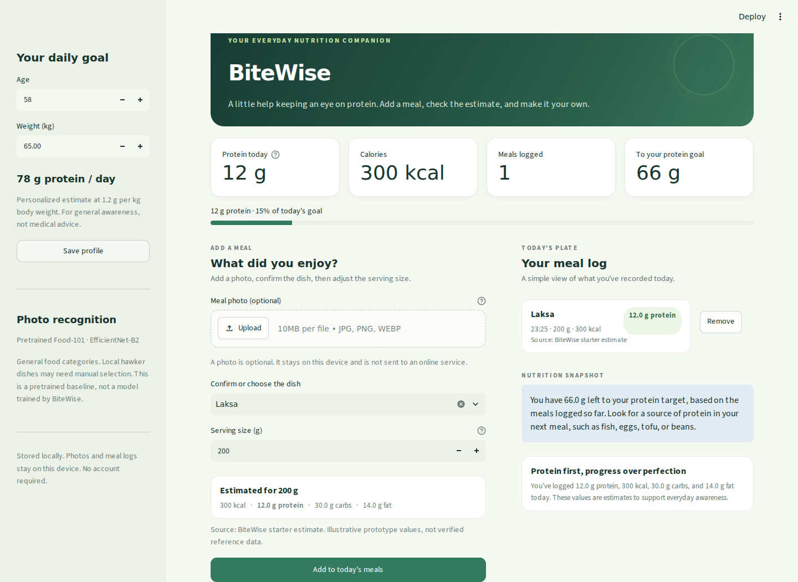

# BiteWise

A local meal-photo and protein-tracking prototype built with Streamlit. Upload a meal, review the model's top three suggestions, confirm or correct the dish, enter its weight, and log an estimated nutrition breakdown. Your daily protein goal is based on body weight at 1.2 g/kg for the intended audience of adults aged 50 and above.



**Recognition works without downloading FoodSG-233 or training a model.** The default is a pretrained [FoodVision Big / EfficientNet-B2 model](https://huggingface.co/shalev396/foodvision-big), trained by its author on Food-101. Setup downloads approximately **32 MB** of model files once. Photos are then classified on your own CPU, with no inference service or API key.

This pretrained baseline covers 101 general food categories. It is **not the custom Singapore food classifier proposed in the original project**. Dishes such as laksa and chicken rice may need manual selection. The original EfficientNet-B0 training path is retained for future FoodSG work.

## Quick start

Tested on WSL/Linux with Python 3.13.11. Use Python 3.11 or newer.

```bash
git clone https://github.com/TheWill-Of-D/bitewise.git
cd bitewise
python3 -m venv .venv
source .venv/bin/activate
```

Install CPU PyTorch first to avoid downloading unnecessary CUDA packages on Linux or Windows:

```bash
python -m pip install torch==2.14.1 torchvision==0.29.1 --index-url https://download.pytorch.org/whl/cpu
python -m pip install -r requirements-model.txt
python setup_model.py
python -m streamlit run app.py
```

Open **http://localhost:8501**. For later runs, activate `.venv` and run only the final command. Stop the server with Ctrl+C.

**Windows PowerShell:** use `python -m venv .venv` and `.\.venv\Scripts\Activate.ps1` instead of the Linux environment commands. Then use the same installation and run commands.

**macOS:** install PyTorch with `python -m pip install torch==2.14.1 torchvision==0.29.1` instead of the CPU-index command, then continue with `requirements-model.txt` and setup. macOS and native Windows have not been tested here.

The setup script downloads a pinned revision, checks file sizes and SHA-256 hashes, and keeps at least 5 GiB of free disk space plus a buffer. On WSL it checks the physical Windows drive backing the Linux disk as well as the Linux filesystem. Model files stay under `models/food101/` and are not committed to GitHub. Internet is required for initial package/model installation; normal app inference is offline. Re-running setup verifies and reuses an intact model.

PyTorch and other Python packages require additional disk space; the 32 MB figure refers only to the model files.

For manual logging without any classifier, install only `requirements.txt` and run the app. No fabricated model predictions are shown.

## Try the workflow

1. Set your weight in the sidebar and save the profile.
2. Upload a JPG, PNG, or WebP photo (up to 10 MB). Food-101 categories such as pizza, sushi, fried rice, and omelette are useful for trying recognition.
3. Review the top three suggestions. The score is relative model confidence, **not a guarantee of correctness**. A score below 60% requires an explicit food choice; this threshold is a UI heuristic, not calibrated uncertainty detection.
4. Confirm or correct the dish in the searchable selector. Unsupported predictions remain visible but do not silently choose a nutrition entry.
5. Enter the serving weight. The nutrition preview updates immediately.
6. Add the meal and watch the protein dashboard update. Remove a meal if it was entered incorrectly.

The model always chooses from its 101 classes, even for unsupported dishes or non-food photos. A high score does not establish that a photo belongs to a supported class. This prototype handles one dish per photo and does not estimate portion mass or separate multiple foods.

## Nutrition data and privacy

`data/nutrition.csv` contains **45 illustrative starter entries**, including 25 Singapore foods and 20 general Food-101 matches. These numbers are placeholders for demonstrating portion calculations; **they are not verified SG FoodID or USDA nutrition records**. Replace them with validated values per 100 g, and put the source URL or record ID in each row's `source` column before using the system for a study.

A predicted label is linked only to an exact corresponding food label. Similar-looking foods are not assumed to have the same nutrients. Portion and recipe variation still affect estimates.

The profile and meal records persist in local `bitewise.sqlite3`; set `BITEWISE_DB_PATH` to use a different database. Uploaded photos are processed in memory, are not written to the meal database, and are not sent to a model provider. Streamlit usage statistics are disabled and the server binds to `127.0.0.1`. Database files, model weights, secrets, and restricted datasets are excluded from git. The app supports general dietary awareness, not medical advice.

## Recognition backends

Set `BITEWISE_MODEL` before starting the app:

| Value | Behavior |
| --- | --- |
| `auto` (default) | Use custom weights if installed; otherwise use the pretrained Food-101 model. |
| `pretrained` | Use `models/food101/` installed by `setup_model.py`. |
| `custom` | Use `models/food_classifier.pt` and `models/class_names.json`. |
| `none` | Manual meal logging without image classification. |

For example, on Linux/WSL: `BITEWISE_MODEL=pretrained python -m streamlit run app.py`. On PowerShell: `$env:BITEWISE_MODEL='pretrained'` followed by the run command. The sidebar identifies the active model. Replacing the model files invalidates the inference cache.

See [custom model training](docs/TRAINING.md) for the original FoodSG-233/EfficientNet-B0 workflow. The default demo does not require FoodSG access. No FoodSG images, private access links, Food-101 images, or user meal records are published with this code.

## Verification

```bash
python -m unittest discover -s tests -v
```

The suite checks portion math, local persistence, removal, profile targets, photo errors, prediction correction, unmapped labels, model-cache behavior, real pretrained inference without downloads, synthetic custom training/checkpoint loading, and the physical disk-space guard. Model tests skip if optional dependencies or downloaded weights are absent.

A real pizza example was also run through the pretrained checkpoint and the browser workflow. This is an integration smoke check, **not a measured Food-101 or Singapore-food accuracy result**. No BiteWise classification accuracy is claimed.

Optional browser checks require Playwright:

```bash
python -m pip install playwright
python -m playwright install --with-deps chromium
python tests/browser_smoke.py
# Exercise actual recognition using your own local food photo:
python tests/browser_smoke.py --real-photo /path/to/pizza.jpg --expected-food Pizza
```

These checks use disposable databases and do not change your real meal log. No user photos or downloaded test examples are included in the repository. GitHub Actions runs the unit and pretrained-model smoke checks.

## Project files

- `app.py`: Streamlit interface and local meal storage.
- `recognition.py`: pretrained/custom inference, preprocessing, and caching.
- `setup_model.py`: small, checksum-verified pretrained model download.
- `data/pretrained_model.json`: pinned upstream revision and artifact hashes.
- `data/nutrition.csv`: replaceable, clearly labeled demonstration nutrition table.
- `train_model.py`: optional custom EfficientNet-B0 training and evaluation.
- `tests/`: workflow, model, download-guard, and browser checks.

## License and attribution

BiteWise source code is MIT licensed. The separately downloaded pretrained model is MIT licensed by its author; see [third-party attribution and license](THIRD_PARTY_NOTICES.md). FoodSG and Food-101 dataset terms are separate from this project's source-code license. Respect the providers' terms when obtaining and using those datasets.
